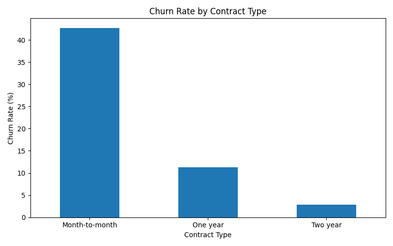
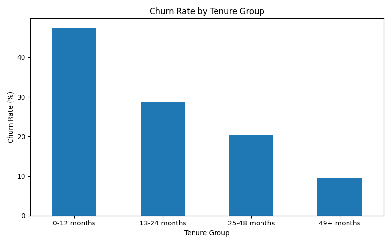
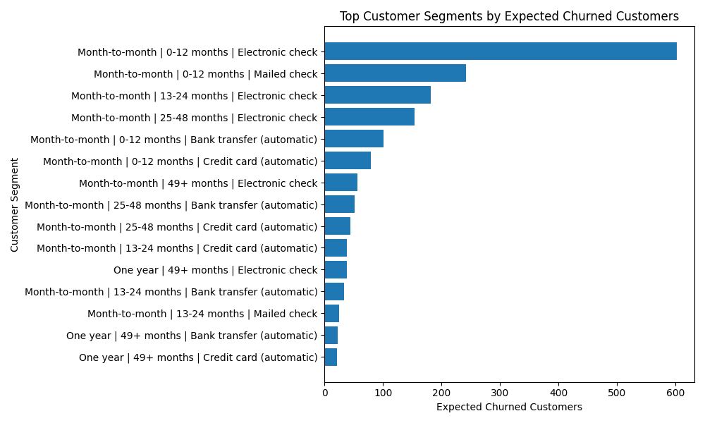
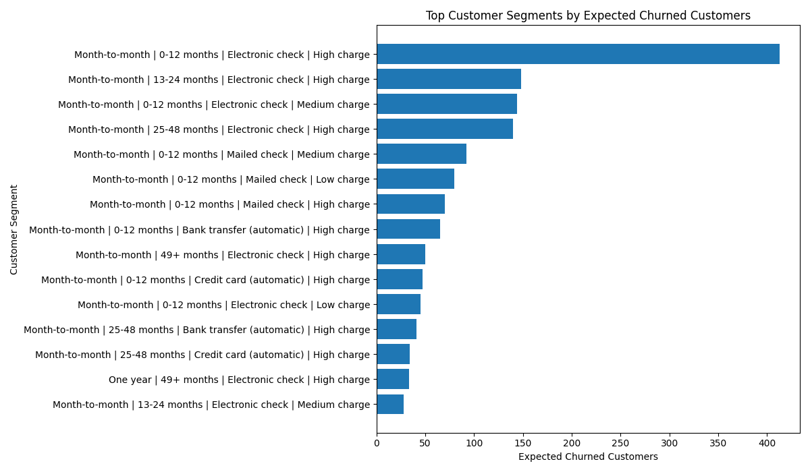

# Telco Customer Churn Analysis

## 1. Business Problem

Telecommunication companies lose revenue when customers stop using their services. This project analyzes customer churn patterns and builds a predictive model to identify customers who are likely to leave.

The goal is to help a telecom company understand the main drivers of churn and recommend actions to improve customer retention.

## 2. Project Objectives

- Understand the characteristics of customers who churn.
- Identify important churn drivers such as contract type, tenure, payment method, and monthly charges.
- Build a machine learning model to predict customer churn.
- Evaluate the model using business-relevant metrics.
- Recommend retention strategies based on the findings.

## 3. Dataset

The project uses the IBM Telco Customer Churn dataset containing **7,043 customer records** and **21 features** describing customer demographics, subscribed services, billing information, and churn status.

The target variable is:

- **Churn** (Yes/No)

Key features include:

- Contract
- Tenure
- MonthlyCharges
- TotalCharges
- PaymentMethod
- InternetService
- OnlineSecurity
- TechSupport

## Technologies Used

- Python
- Pandas
- NumPy
- Matplotlib
- Scikit-learn
- SQL
- Git
- GitHub
- Jupyter Notebook

## 5. Key Business Questions

1. What percentage of customers churned?
2. Which contract types have the highest churn?
3. Does customer tenure affect churn?
4. Do customers with higher monthly charges churn more?
5. Which payment methods are associated with higher churn?
6. Can we predict whether a customer will churn?

## 6. Expected Outcome

The final output will include:

- SQL analysis
- Exploratory data analysis
- Churn prediction model
- Model evaluation
- Business recommendations

## Key Findings

### 1. Overall churn rate

The dataset contains 7,043 customers, with an overall churn rate of approximately 26.54%.

### 2. Contract type is a major churn driver

Customers on month-to-month contracts have the highest churn rate at approximately 42.71%, compared to 11.27% for one-year contracts and 2.83% for two-year contracts.

### 3. New customers are most at risk

Customers with 0–12 months tenure have the highest churn rate at approximately 47.44%. Churn decreases as tenure increases.

### 4. Payment method matters

Customers using electronic check have the highest churn rate among payment methods at approximately 45.29%.

### 5. Highest-risk segment

The highest-risk customer profile is:

- Month-to-month contract
- 0–12 months tenure
- Electronic check payment method
- High monthly charges

This segment has a churn rate of approximately 70.24% and contributes an estimated 413 churned customers.

## Modeling Summary

A Logistic Regression model was trained as the baseline model.

At the default threshold of 0.50:

- Accuracy: approximately 80%
- Churn precision: 65%
- Churn recall: 52%
- Churn F1-score: 58%

After lowering the threshold to 0.40:

- Accuracy: approximately 78%
- Churn precision: 58%
- Churn recall: 66%
- Churn F1-score: 62%

Lowering the threshold improved the model’s ability to identify churners, which may be useful if retention actions are low-cost.

## Business Recommendations

### Recommendation 1

Target new month-to-month customers during their first year.

---

### Recommendation 2

Encourage customers to adopt longer-term contracts.

---

### Recommendation 3

Investigate why customers paying via electronic check churn significantly more often than customers using automatic payment methods.

---

### Recommendation 4

Prioritize retention campaigns for customers with high monthly charges, as they represent the highest potential revenue loss.